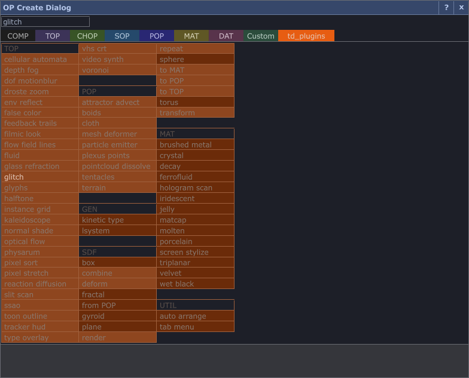

# UTIL_tab_menu

Adds a **new tab** to TouchDesigner's OP Create dialog (the Tab menu) that lists every component of this
library, grouped by family (TOP, POP, GEN, SDF, MAT, UTIL). Picking one creates it like a built-in operator.

## Use
1. Drop `tox/UTIL/UTIL_tab_menu.tox` into your project (any network; it does not need inputs or wires) and keep it there.
2. It installs itself (Autoinstall). `Status` says `installed: tab "td_plugins", N entries`; otherwise pulse **Install**.
3. Press Tab (or double-click) in any network editor: choose the last tab, **td_plugins**. The search field filters it
   like the built-in tabs (name, short name, description; non-matches are dimmed, the best match is highlighted). Hovering an entry shows its description and inputs/outputs in the dialog's bottom text area.
4. Click an entry: a Base COMP with the component is created, named like the component with a counter
   (`TOP_glitch1`, `TOP_glitch2`...), in the network the dialog was opened for, and attached to the cursor for
   placement (same as built-in operators). Undo removes it.

The tab is labelled by `Tablabel` (default `td-plugins`). The label is also the dialog's internal family name, so it is
converted to a legal operator name: it is displayed as `td_plugins`. Use e.g. `tdplugins` if you prefer.

## Parameters (Controls)
| Parameter | |
|---|---|
| Install / Uninstall | patch / restore the dialog (idempotent; Install does nothing when already installed) |
| Auto Install (default on) | install when the project starts and when the component is created or loaded |
| Refresh List | rescan `<Libraryroot>/tox/*/*.tox` (Library Root on the About page: `TD_PLUGINS_HOME` or `~/software/td-plugins`) |
| Tab Label | name of the tab (changing it re-installs) |
| Create Mode | `embed` (default): the new COMP contains a copy of the tox (`loadTox`); `link`: a Base COMP whose External Tox points at the library tox (expression honouring `TD_PLUGINS_HOME`) and stays up to date |
| Status | read-only: `not installed`, `installed: ...`, `active via <other component>`, `INCOMPATIBLE ...` (reason), `error: ...` |

`out1` (Out DAT): table `name, family, tox` of the entries currently installed in the dialog (empty when uninstalled).

## Persistence: /ui is rebuilt on every launch
The OP Create dialog lives in TouchDesigner's system UI network (`/ui`), which is rebuilt each launch and never saved
with a project. Patches therefore do not persist: **keep this component in your project (or in a startup template /
the palette's startup project) so it re-installs on start** (Execute DAT `start`: onStart and onCreate, a few frames
after load, only when Autoinstall is on). Nothing about the patches is saved in your `.toe`: the stored originals are
taken out of the component's storage while the project is saved (onProjectPreSave/PostSave).

## Implementation (exactly what is patched in /ui/dialogs/menu_op, and how it is restored)
All patches are made by `<comp>/tdp` (module), each is checked first (see Version guard) and each is undone exactly.

| # | Operator (under `/ui/dialogs/menu_op`) | Patch |
|---|---|---|
| 1 | `tdp_insert` (new Insert DAT) | appends the tab name as a column after the stock `insert1` (which adds "Custom"); `transpose1` is rewired from `insert1` to `tdp_insert`. The stock chain (`select_family` > `select_available` > families/family) then shows the new tab last. Restore: `transpose1` back on `insert1`, `tdp_insert` destroyed. |
| 2 | `colors` (Table DAT) | one row `'<key>'  r g b` (copper). The dialog derives the tab's default/hover/selected/disabled colours (`allColors`) from it. |
| 3 | `compatible` (Table DAT) | a column and a row `<key>` filled with `x` ("all operators"), so the tab is also offered when the dialog is opened by dragging a wire out of a node. |
| 4 | `nodetable/script1_callbacks` (Script DAT callbacks) | block inserted after the line `currFamily = scriptOp.inputs[0][0,0].val`: when the selected tab is ours, `<comp>/tdp.module.cook(scriptOp, key)` fills the table (same columns as the stock `cook`: heading rows, entries, scores for search, layouts per entry) and returns; any error leaves an empty tab. |
| 5 | `create_node` (Text DAT; `node_script`, the Panel Execute that runs the click, mirrors its text) | block inserted before `if($custom == "custom")`: rows whose `ordering` column is `tdplugins` run `<comp>/create "<pane>~<operator>~<nodepath>~<connectmode>~<type>~<connector>~<index>"` and exit; every other row follows the unchanged stock code. |
| 6 | `launch_menu_op` (Text DAT) | two `cvar` lines after `cvar source = $source` remember the wire's node path and connector index (the stock script drops them) for the wiring of new components. |
| 6b | `panelexec1` (Panel Execute; hover handler) | block inserted after the line `ty = op('current').text.strip()`: when the active tab is ours, the hovered cell's text comes from `<comp>/tdp.module.help(name, label)` instead of the stock `summaries` lookup, then returns. Entry: the description from components.json / meta.json, a blank line, then `In: ... Out: ...` from `labels.json`. Family heading rows show a one-line blurb (e.g. "TOP_: image filters and effects"). Built-in tabs are untouched. |
| 7 | `nodetable/layouts/<key>` (new COMP) | copy of `nodetable/layouts/master`: the cell styles (`defFilter`, `defGenerator`, `defLabel`, `...Disable`) of our entries, coloured from row 2. |
| 8 | `families/family/layouts/<key>` | created by the stock replicator from the family list (a copy is made if it did not); its tab width is set to fit the label (the stock tab buttons are 58 px wide). Only this copy is edited. |

Each inserted block is delimited by `# >>> td-plugins UTIL_tab_menu >>> owner=<comp path> key=<key>` and
`# <<< td-plugins UTIL_tab_menu <<<`. The marker identifies the owner: a second UTIL_tab_menu does not patch
twice (`Status`: `active via ...`), and a marker whose owner no longer exists is cleaned up before installing.

**Restore.** Before touching anything the original text of the four DATs and the two tables is stored in the
component's storage (`orig`), mirrored in memory. Uninstall, destroying the component (an extension's `__delTD__`,
also when a parent network is deleted), changing `Tablabel`, or renaming/moving it (OP Execute `watch`) put the exact
texts back, destroy the added operators, reconnect `transpose1`, drop the layouts, and, if the tab was active, return
the dialog to its first tab. If the originals are missing (stale patch) the blocks are stripped by their markers and
the added rows/column removed. Tested: all DATs of `/ui/dialogs/menu_op` hash identical to before after uninstall/destroy.

**Version guard.** Before patching, `check()` verifies: the operators above exist and have the expected types
(`insert1`, `transpose1` fed by `insert1`, `colors`, `compatible`, `connectto`, `create_node`, `launch_menu_op`,
`nodetable/script1_callbacks`, `panelexec1`, `nodetable/families` Script DAT, `nodetable/layouts/master`, the family replicator),
the four anchor lines are present exactly once and `launch_menu_op` still takes `pane type source index nodepath`.
If anything differs (e.g. after a TouchDesigner update) nothing is patched, `Status` reads
`INCOMPATIBLE OP Create dialog, not patched: <reasons>` and a warning is printed. Developed against 2025.32820.

## Creating, wiring, undo
* Creation is `network.loadTox(tox)` (embed) or a Base COMP + External Tox + load (link), named `<NAME><n>`, inside the
  pane's network, then `placeOPs` attaches it to the cursor (like a built-in operator). Creation is one undo block.
* Wire drag: when the dialog is opened by dragging out of a node's output (or input) the tab is offered too; the new
  component's first input (output) is connected to that connector when the connector family matches the component's
  `in1` (`out1`) family, e.g. a TOP wire into `TOP_glitch`. GEN_/UTIL_/MAT_ components have no matching input and are
  just created. Mismatches are left unconnected (no error).

## Limitations
* The tab key is a legal operator name (hyphens become underscores); the tab is as wide as its label allows.
* Search works inside the tab (the dialog has no cross-tab search); there is no "All" tab to search from.
* Shift/Ctrl multi-add (keep the dialog open, chain nodes) is not provided; one click creates one component.
* Right-click on an entry does nothing: the stock right-click menu (wiki page, Derivative snippets) only opens for rows with an `opType`, and ours have none, so no Derivative wiki page can be opened for a library component. The dialog's top-right `?` is the dialog's own help and is unchanged. Use the component's About > Help pulse for its README.
* Only one UTIL_tab_menu can own the patch at a time. Components created from the tab are plain Base COMPs: with
  `embed` they do not follow library updates, with `link` they depend on the library path.
* The list is read from the built `tox/<FAMILY>/*.tox` files; `Refresh List` after adding or rebuilding components.
